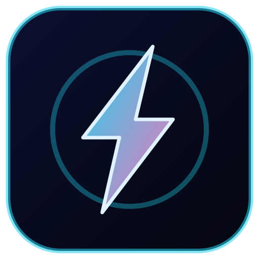

# Graviton Rush 🚀

Runner de arcade de **un solo botón**: el personaje corre solo y cada toque
**invierte la gravedad**. Esquiva picos, bloques y láseres, aguanta la velocidad
creciente y supera tu propio récord.

Hecho con **Godot 4.3**, sin texturas ni audio externos (todo se dibuja por
código) y con un workflow de **GitHub Actions** que compila el APK y lo deja
como artefacto descargable. **No hace falta instalar nada en tu PC**: la
compilación ocurre en los runners de GitHub.



## Cómo se juega

| Acción | Resultado |
|---|---|
| Tocar la pantalla (cualquier punto) | Invierte la gravedad: saltas del piso al techo o viceversa |
| Tocar en la pantalla de inicio | Empieza la partida |
| Tocar al morir (tras 0,55 s) | Reinicia |
| Espacio / Enter (escritorio) | Equivalente al toque |

- La velocidad sube con la distancia: de 560 px/s a 1000 px/s.
- El récord se guarda en `user://graviton_rush_save.json` dentro del teléfono.
- Sin anuncios, sin permisos, sin conexión.

## Compilar el APK en GitHub (paso a paso)

1. **Crea el repositorio vacío** en GitHub: <https://github.com/new>.
   - Nombre sugerido: `graviton-rush`. No marques "Add a README".
2. **Sube este proyecto** (desde la carpeta del proyecto):

   ```bash
   git remote add origin https://github.com/<TU_USUARIO>/graviton-rush.git
   git push -u origin main
   ```

   Si te pide credenciales, usa un **Personal Access Token** (GitHub → Settings →
   Developer settings → Tokens (classic) → `repo`) como contraseña, o configura SSH.
   También puedes subir los archivos desde la web de GitHub ("Add file → Upload files").
3. Entra a la pestaña **Actions → Build APK** del repositorio. El push a `main`
   dispara el build automáticamente (tarda ~4-6 min; casi todo es descargar la
   imagen con Godot + Android SDK).
4. Cuando el run esté en verde, abre el run y descarga el artefacto
   **`graviton-rush-apk`** (es un `.zip` con `graviton-rush.apk`).
5. Instala el APK en el teléfono (activa "Instalar apps de origen desconocido"
   para tu explorador de archivos). Está firmado en modo **debug**: sirve para
   probar, no para publicar en Play Store.
6. Para volver a compilar sin cambiar código: **Actions → Build APK → Run workflow**.

### Qué revisa el workflow

- Prepara Godot 4.3 + export templates + Android SDK + keystore debug dentro del
  contenedor `barichello/godot-ci:4.3`.
- Importa recursos y exporta el preset `Android Debug` a `build/graviton-rush.apk`.
- Verifica que el APK exista y muestra su `package`/`versionName` con `aapt`.
- Publica el APK como artefacto y, **después** de subirlo, corre un smoke test
  headless de la lógica. Si el smoke test falla, el run queda en rojo pero el APK
  ya está descargable en el artefacto (útil para diagnosticar sin bloquear la entrega).

## Estructura

```
project.godot              Configuración: 720x1280, portrait, GL Compatibility
export_presets.cfg         Preset "Android Debug" (APK precompilada + firma debug)
icon.svg                   Icono vectorial (lo usa el launcher de Android)
scenes/Main.tscn           Escena raíz mínima (solo un Node2D con game.gd)
scripts/game.gd            Estados, entrada, puntaje, récord y guardado
scripts/player.gd          Gravedad invertible, estela, squash/stretch
scripts/world.gd           Fondo parallax, skyline, grid, líneas de piso/techo
scripts/spawner.gd         Módulos procedurales + limpieza (queue_free)
scripts/obstacle.gd        Picos, bloques, láser pulsante y pilares
scripts/effects.gd         Pool de partículas (máx. 180) + screen shake
scripts/hud.gd             Puntaje, récord y pantallas de inicio/muerte/pausa
tests/smoke.gd             Prueba headless de la lógica principal
.github/workflows/build-apk.yml  CI que produce el APK
```

## Balance y ajustes rápidos

Casi todo el "feeling" está en `scripts/game.gd` y `scripts/player.gd`:

| Constante | Dónde | Efecto |
|---|---|---|
| `BASE_SPEED` / `MAX_SPEED` | `game.gd` | Velocidad inicial y máxima |
| `SPEED_PER_METER` | `game.gd` | Cuánto acelera por metro |
| `FLIP_TIME` | `player.gd` | Duración del salto entre piso y techo |
| `DEATH_LOCK` | `game.gd` | Retardo antes de poder reintentar |
| `gap` y `_pick_kind()` | `spawner.gd` | Separación y mezcla de obstáculos |
| `MAX_PARTICLES` | `effects.gd` | Coste de partículas |

## Abrir el proyecto en Godot (opcional)

1. Descarga Godot **4.3** (standard, sin .NET).
2. Project Manager → Import → selecciona `project.godot`.
3. F5 para probar en escritorio (clic izquierdo = toque).
4. Para exportar por tu cuenta: Editor → Manage Export Templates → instalar
   templates de 4.3 y configurar el SDK de Android como explica la
   [documentación oficial](https://docs.godotengine.org/en/4.3/tutorials/export/exporting_for_android.html).

## Solución de problemas

| Síntoma en el log de Actions | Qué hacer |
|---|---|
| `No export template found at ...` | Cambia `4.3` en el `image:` del workflow y en el preset, o revisa el paso "Preparar Godot..." (`ls` de plantillas). |
| `Android build template not installed` | El preset debe tener `gradle_build/use_gradle_build=false` (este repo ya lo trae). |
| `Unable to find apksigner` | Revisa que `/usr/lib/android-sdk/build-tools` exista (el paso de preparación lo imprime). |
| `Could not find keystore` | Borra `$HOME/.config/godot` en el paso de preparación para que se reescriba `editor_settings-4.3.tres`. |
| `Export successful` pero el juego no arranca | Revisa el smoke test y el log `--verbose` del export; los errores de GDScript aparecen ahí. |
| Run en rojo por Docker Hub | Re-ejecuta el workflow desde la UI ("Re-run jobs"); es un límite de pulls. |

## Publicar en Play Store (fuera de alcance)

El APK actual va firmado con la clave debug del contenedor. Para publicar haría
falta un keystore de release (base64 en GitHub Secrets), `export_presets.cfg`
con `keystore/release*` y `version/code` incrementado. Este repo deja el camino
de compilación listo para añadirlo.

## Licencia

MIT — ver [LICENSE](LICENSE).
